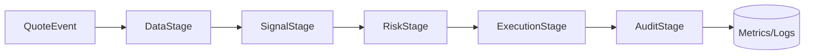

# futu-quant-trader

Production-ready Python algorithmic trading framework for Futu/Futubull OpenAPI.

## Architecture



## Prerequisites

- Python 3.12+
- Poetry
- Futu OpenD gateway
- Futu paper trading account

## Quick start

### 1. Environment setup

```bash
cp .env.example .env
# Edit .env and set FUTU_ACCOUNT_ID
```

### 2. Docker Compose

```bash
docker compose up --build
```

### 3. Local development

```bash
conda activate futunn  # or your Python 3.12+ environment
poetry install --with dev
```

## Configuration

Configuration files live under `config/` (`config.dev.yaml`, `config.staging.yaml`, `config.prod.yaml`).

`${ENV}` placeholders (e.g. `${FUTU_ACCOUNT_ID}`) are resolved at runtime via `os.environ`.

| Section     | Purpose                                     |
|-------------|---------------------------------------------|
| `opend`     | Gateway host/port, heartbeat, reconnect, rate-limit |
| `trading`   | Account, symbols, limits, cooldown          |
| `model`     | Model type/path/hot-reload/threshold        |
| `pipeline`  | Queue and feature window sizing             |
| `logging`   | JSON log output and rotation                |
| `metrics`   | Prometheus metrics port                     |

## Run backtests

```bash
PYTHONPATH=src python scripts/run_backtest.py
```

> **Note:** `run_backtest.py` currently runs `Backtester().run([])` regardless of CLI arguments.

## Download history, research and train

```bash
# 1. Download daily bars from a running OpenD into data/raw/ (CSV cache)
PYTHONPATH=src python scripts/fetch_historical_data.py --symbol HK.00700,HK.09988 --start 2016-01-01

# 2. Grid search features x labels x models x hyperparameters (purged walk-forward, net of costs)
PYTHONPATH=src python -m trader.research.grid_search --spec config/research.example.yaml --dry-run
PYTHONPATH=src python -m trader.research.grid_search --spec config/research.example.yaml
#    no data yet? add --synthetic to try the pipeline on generated bars

# 3. Train a model the live pipeline can run (features from the `live` group)
PYTHONPATH=src python -m trader.model.trainer --model lightgbm --symbols HK.00700 --horizon 5
```

Each grid-search run writes `trials.jsonl` (every trial, with data hash and commit),
`leaderboard.csv`, `summary.json` (winner plus its deflated Sharpe ratio, which discounts for the
number of trials) and `best_model.joblib` under `data/research/<run>/`. Edit
`config/research.example.yaml` to change the grid: any scalar given as a list becomes a dimension.

To trade a trained model, set `model.type` to its estimator (`lightgbm`, `linear`, `sklearn_gbm`)
and `model.path` to the artifact. Startup fails if the file is missing or the model uses features
the live `DataStage` does not compute. Treat synthetic or in-sample numbers as plumbing checks,
not evidence of an edge.

### Monte Carlo voting plans (buy, take-profit and stop prices)

```bash
PYTHONPATH=src python -m trader.research.plan_backtest backtest --spec config/montecarlo.example.yaml
PYTHONPATH=src python -m trader.research.plan_backtest plan --spec config/montecarlo.example.yaml
```

Many randomised models (random estimator, hyperparameters, feature subset and bootstrap of
training dates) vote on the direction of the next N bars. If a side gets enough votes, its
median prediction drives simulated price paths, which set a limit entry, a take-profit and a stop
with stated fill, target and stop probabilities. `backtest` runs this walk-forward and executes
the plans on real bar highs and lows net of costs. It also reports `vote_calibration.csv`, which
shows whether bigger majorities are actually right more often. `plan` prints today's plan per
symbol. Plans are research output; nothing places orders.

### Price patterns (candlesticks, chart patterns and a neural recognizer)

```bash
PYTHONPATH=src python -m trader.patterns train --symbols HK.00700,HK.09988   # writes data/models/pattern_recognizer.pt
PYTHONPATH=src python -m trader.patterns scan --symbol HK.00700              # patterns in the recent bars
PYTHONPATH=src python -m trader.patterns stats --symbols HK.00700,HK.09988 --horizon 10
#    add --synthetic to any command to try it without downloaded data
```

- 51 candlestick patterns (doji, hammer, engulfing, harami, morning/evening star, three white
  soldiers, three methods and more) are rule-based, because a candlestick pattern is a
  definition.
- 25 chart patterns (double/triple top and bottom, head and shoulders, triangles, wedges,
  channels, rectangles, broadening, flags, pennants, cup and handle, rounding and V turns) are
  found two ways: explainable rules on ATR-scaled swing pivots, and a 1-D CNN trained on
  synthetic examples plus real windows labelled by the rules. Both report each pattern only from
  the bar where it became visible, so they can be used as features without look-ahead.
- `stats` shows the forward return after each pattern, signed by its usual direction. Check it
  before trusting any pattern: recognising a shape is not the same as predicting a move.

Feature groups `candle_patterns` and `chart_patterns` expose the detectors to the grid search
and the Monte Carlo planner, next to the indicator groups `moving_averages`, `momentum_ext`,
`trend_ext`, `volatility_ext`, `volume_ext` and `support_resistance`.

GitHub Actions: run `Model Train` workflow manually (needs OpenD reachable from the runner).

## Paper trading

```bash
PYTHONPATH=src python -m trader --mode paper --duration 300
```

Requires Futu OpenD gateway at `127.0.0.1:11111`. Without it, the client falls back to paper mode automatically.

## Daily signal orders (cron)

```bash
# Preview: signals, sizing and risk checks for every configured symbol, no orders sent
PYTHONPATH=src python -m trader --daily-signals --dry-run --config config/config.staging.yaml
# Paper (SIMULATE) orders
PYTHONPATH=src python -m trader --daily-signals --mode paper --config config/config.staging.yaml
```

Run once per trading day during the continuous session; `deploy/cron/daily-signals.cron` runs it
Mon-Fri at 09:35 HKT. For each symbol the job downloads daily bars from OpenD, keeps only
completed sessions (today's forming bar is dropped), replays the closes through `DataStage` and
the configured model, and if the signal is BUY or SELL above `model.confidence_threshold` sends a
LIMIT order at the previous session's close through the normal risk and execution stages.
HOLD or low-confidence signals place nothing; a SELL needs a sellable position unless
`risk.allow_short` is set. The risk price band rejects the order when today's price has gapped
more than `risk.price_band_pct` from the close.

Safety: it skips non-trading days (OpenD calendar plus `session.holidays`), refuses bars that do
not end on the previous trading session, sends nothing outside the HK continuous session (except
with `--dry-run`), and records each acted-on session in `daily.state_file`
(`data/state/daily_signals.json`) so a repeated run never sends a second order. Orders are left
working on exit. Live trading uses the same opt-in gate as the streaming pipeline. Supported
markets: HK and crypto (`CC`); other markets are refused until their session hours are added.
The JSON summary goes to stdout; the exit code is 1 if any symbol errored.

Optional config block (defaults shown):

```yaml
daily:
  history_days: 400        # calendar days of bars; must cover pipeline.data_window_size sessions
  ktype: "K_DAY"
  state_file: "data/state/daily_signals.json"
```

## Production deployment

Use `deploy-prod.yml` workflow with environment approval to build and deploy the Docker image.

## Observability

- Prometheus metrics: queue depth, throughput, stage-level counters
- Grafana dashboard template: `docs/grafana_dashboard.json`

## Risk disclaimer

Trading involves substantial risk of loss. Use paper trading and staged deployment before any live capital deployment. Ensure compliance with local laws and broker terms.

## Development

```bash
ruff check src/ tests/
ruff format --check .
mypy src
PYTHONPATH=src pytest tests/unit tests/integration --cov=src/trader --cov-report=xml --cov-fail-under=75
```

## Documentation

- `docs/architecture.md` — pipeline stages, factory, models, risk gates, data flow
- `docs/api-reference.md` — public classes, methods, and typed payloads
- `docs/runbook.md` — operations, health checks, troubleshooting
- `AGENTS.md` — contributor/agent commands and repo conventions
