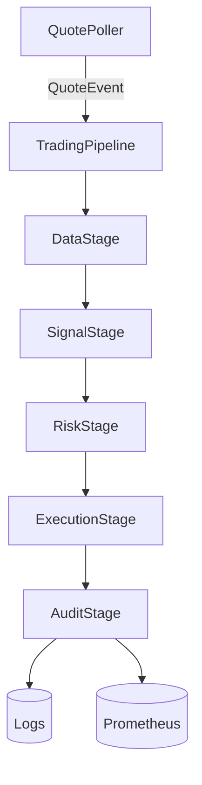

# Architecture

## Overview

Event-driven asyncio pipeline for automated trading on the Futu/Futubull OpenAPI.



## Package layout

```
src/trader/
  core/        domain types: orders, symbols, market rules, events, clock (no futu/pandas/pydantic)
  ports/       BrokerClient protocol and typed broker responses
  adapters/    futu/ (equity + crypto clients, FutuMarket profiles), sim/ (paper), factory.py
  marketdata/  quote poller and quote events
  risk/        PreTradeRisk, portfolio state, RiskEngine, Kelly, kill switch, throttle
  execution/   OrderManager
  data/        live + research features, indicators, history fetcher
  model/       signal models and the model registry
  pipeline/    stages, IPipelineFactory, TradingPipeline
  jobs/        scheduled jobs (daily signals)
  research/    offline research (grid search, Monte Carlo plans); patterns/ pattern detectors
  app/         cli, runtime (live opt-in, shutdown), health, bootstrap (composition root)
  config.py    AppConfig schema and loader
```

Dependency rules are checked in CI by `lint-imports` (contracts in `pyproject.toml`):

- `core` imports no other `trader` package and no futu, pandas or pydantic.
- Only `app` may import `adapters` (or `app`). Everything else talks to the broker through `ports`.
- `ports` never imports futu.
- The live path (`app`, `pipeline`, `risk`, `execution`, `marketdata`, `ports`, `adapters`)
  never imports `research`.

## Pipeline stages

| Stage | Input | Output | Responsibility |
|-------|-------|--------|----------------|
| `DataStage` | `QuoteEvent` | `FeatureWindow` | Per-symbol rolling price windows; computes z-score, momentum, EMA trend strength, volatility, RSI, Bollinger-band position, price acceleration |
| `SignalStage` | `FeatureWindow` | `TradeSignal` or `None` | Model inference (`ISignalModel`), confidence threshold gate, per-symbol cooldown |
| `RiskStage` | `TradeSignal` | `ApprovedOrder` or `None` | `RiskEngine` hard-gate checks + `KellyCriterion` sizing scaled by signal confidence |
| `ExecutionStage` | `ApprovedOrder` | `OrderReceipt` | `OrderManager` idempotent order placement |
| `AuditStage` | `OrderReceipt` | `None` | Bounded event buffer, structured logging |

All stages implement `IStage[InputT, OutputT]` (`src/trader/pipeline/base.py`). The
`TradingPipeline` worker runs them sequentially per event and records Prometheus
throughput per stage plus queue depth.

## Factory pattern

`TradingPipeline` takes an `IPipelineFactory` (`src/trader/pipeline/factory.py`). The concrete
`DefaultPipelineFactory` (`src/trader/app/bootstrap.py`) is the composition root: it builds every
stage from `AppConfig` and a `BrokerClient`, creating the broker adapter itself only when none is
given. Implement `IPipelineFactory` to create custom stage configurations.

Model selection is a registry (`src/trader/model/registry.py`: `build_model`, `register_model`)
keyed by `model.type` from config:

- `mean_reversion` (default, and the fallback for unknown types) — `MeanReversionModel`
- `ensemble` — weighted `EnsembleSignalModel` of three mean-reversion variants
- `gradient_boosting`, `tabular` and every `TabularModel` estimator — fitted artifacts loaded from
  `model.path`; startup fails if the file is missing or the model needs non-live features

## Models

Models implement `ISignalModel` (`src/trader/model/base.py`):

- **MeanReversionModel** — z-score threshold rules with momentum confirmation (default, wired into factory)
- **EnsembleSignalModel** — weighted voting across member models with per-member error isolation
- **GradientBoostingModel** — scikit-learn `GradientBoostingClassifier` (optional dependency)
- **TransformerPriceModel** — Transformer encoder for price prediction (optional dependency)
- **LSTMModel** — PyTorch network scaffold; does not implement `ISignalModel` yet and is not wired into the factory

## Feature engineering

`src/trader/data/features.py` is the single feature module. `DataStage` calls
`window_features` on each quote's rolling window; training replays the same function over
bar history (`live_feature_frame`), with a parity test. Research-only groups (momentum,
reversal, trend, oscillators, volatility, volume) are vectorised in `build_features`.

## Risk engine

`RiskEngine` (`src/trader/risk/risk_engine.py`) enforces ordered hard gates under a 1ms latency budget; the first failing gate decides the rejection reason:

1. Per-symbol notional limit
2. Portfolio-wide notional limit
3. Daily loss limit
4. Max open orders
5. Zero portfolio value check
6. Concentration limit (% of portfolio)
7. Latency budget exceeded

`KellyCriterion` (`src/trader/risk/kelly_criterion.py`) computes fractional Kelly position sizing; `PreTradeRisk` scales it by signal confidence (≥0.85 → full, ≥0.70 → 60%, below → 30%).

`PreTradeRisk` (`src/trader/risk/pre_trade.py`) is the pre-trade risk service: kill switch, live portfolio state
(`src/trader/risk/portfolio_state.py`, working BUY orders included), lot/step/tick rules, price band, sizing, the
`RiskEngine` gates and the order-rate throttle. It returns an `OrderIntent` or a `Rejection(reason)`. `RiskStage`
is only the pipeline adapter: it drops HOLD signals, calls `PreTradeRisk.check` and counts reject reasons. Code
outside the pipeline (scheduled jobs) should call `PreTradeRisk` directly rather than re-implement any check.

## Broker port and adapters

Risk, execution, the pipeline and the runtime depend on the `BrokerClient` protocol
(`src/trader/ports/broker.py`) and its typed responses (`src/trader/ports/models.py`), never on
a concrete client. `src/trader/adapters/factory.py` picks the adapter for `trading.market`.

`FutuClient` (`src/trader/adapters/futu/client.py`) is the Futu adapter. Everything that differs
between markets lives in a `FutuMarket` profile (`src/trader/adapters/futu/markets.py`):
`EquityMarket` (whole shares, `OpenSecTradeContext`) and `CryptoMarket`
(`src/trader/adapters/futu/crypto.py`: decimal quantities, GTC/IOC, account-currency checks,
simulator-only outside REAL). A new market is a new profile, not a client subclass.

`FutuClient` wraps Futu OpenD with:

- Async context manager lifecycle
- Bounded reconnect with exponential backoff + jitter
- Token-bucket rate limiting
- Heartbeat loop
- Paper-mode fallback when the gateway is unavailable (`PaperSimulator`, `src/trader/adapters/sim/`). Only a client allowed to fall back is given a simulator, so a live client cannot reach one.

## Data flow

1. `QuotePoller` polls quotes at a configurable interval, emits `QuoteEvent` into the pipeline queue
2. `DataStage` enriches the quote with rolling-window features (z-score, momentum, trend strength, volatility, RSI, Bollinger position, acceleration)
3. `SignalStage` runs model inference and gates on confidence threshold and cooldown
4. `RiskStage` evaluates risk hard-gates and sizes the position via Kelly criterion
5. `ExecutionStage` places the order through `OrderManager`
6. `AuditStage` logs the event and updates Prometheus counters
